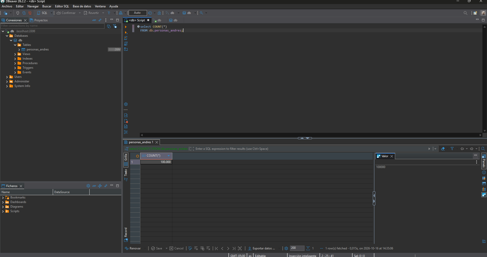
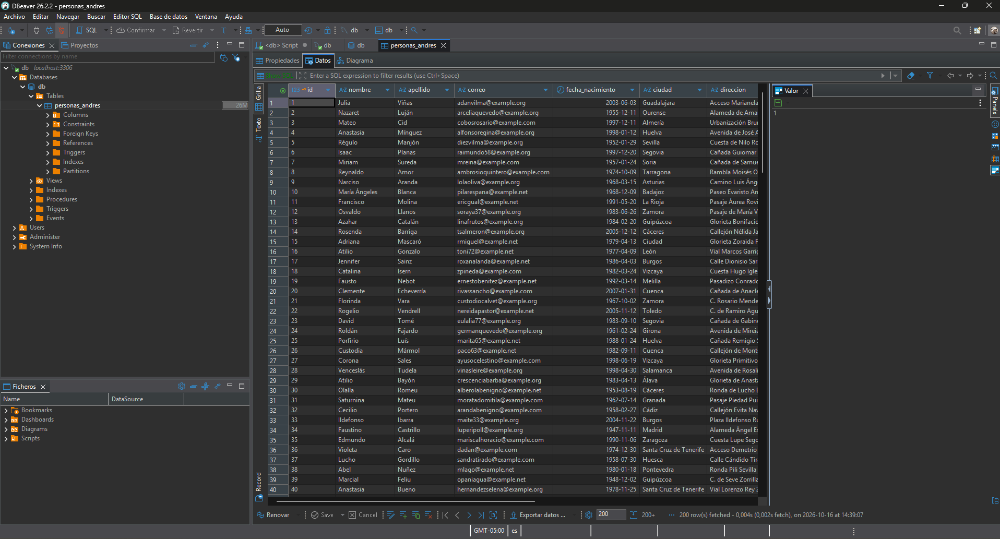

# Proyecto de carga masiva de datos

Este proyecto genera 100.000 registros falsos con Faker y los inserta en MySQL usando SQLAlchemy.

## Requisitos

- Python 3.10 o superior
- MySQL 8
- Git

## Dependencias

Las dependencias necesarias se encuentran en `requirements.txt`:

- SQLAlchemy
- Faker
- python-dotenv
- PyMySQL
- cryptography

## Clonar el proyecto

```bash
git clone https://github.com/Andresnanclares/Taller-U3
cd taller3
```

## Instalar dependencias

```bash
pip install -r requirements.txt
```

## Configurar MySQL

1. Asegúrate de que MySQL 8 esté ejecutándose localmente.
2. Configura las credenciales en `.env`:

## Ejecutar el script

```bash
python main.py
```

El script crea la base de datos si no existe, elimina la tabla antes de insertar los datos y genera 100.000 registros.

## Resultado esperado

Al finalizar, deberías ver un mensaje similar a este:

```text
Se insertaron 100000 registros en la tabla personas_andres.
```

## Capturas de resultados





